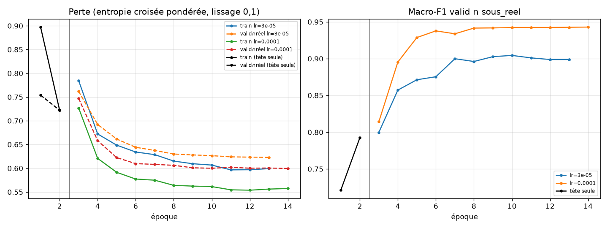

# Rapport d'entraînement : modèle mobile de statut de propreté

Exécuté le 2026-10-28. Code : `code/e0_…` à `code/e9_…`, configuration et graine (42) dans `config.py`.
Tableaux complets : `resultats/tableaux_rapport.md` (généré par `code/tableaux_rapport.py` à partir de `resultats/metriques.json`).

**Discipline du test.** Les étapes 1 à 7 n'ont calculé aucune métrique sur test. Le test a été évalué **une seule fois**, à l'étape 8, une fois tout figé. Aucun entraînement n'a été relancé après. Avant ce passage, j'ai fait un essai à blanc du script de l'étape 8 sur 40 images de **valid** seulement, pour vérifier qu'il tournait sans erreur.

---

## 1. Vérification de départ, environnement, poids

**Étape 0** (`donnees_derivees/verification_depart.json`) : statut **OK**.

| contrôle | résultat |
|---|---|
| lignes du CSV / inclus = 1 | 9 483 / 9 483 |
| effectifs (tout et sous_reel, par split et classe) | identiques aux effectifs attendus (0 écart) |
| `splits_figes.csv` contre CSV | 0 différence |
| fichiers image : présents, lisibles, RGB 640x640 | 9 483 / 9 483, 0 problème ; MD5 identiques à la colonne `md5` |
| embeddings existants (3 caches) | 8 939 ids réutilisables, **0 sha256 différent** ; 393 ids en trop (PROPRE GBS exclues par le filtre catalogue, ignorées) ; 544 manquants = les 544 synthétiques |

**Environnement**

- Windows 11 ; processeur Intel Core i5-11400H ; 15,7 Go de RAM ; GPU **NVIDIA GeForce RTX 2050 (4 Go)**, pilote 555.97.
- Python 3.13.15 ; torch 2.14.1+cu126 ; torchvision 0.29.1+cu126 ; CUDA 12.6 ; cuDNN 9.1 ; transformers 5.21.0 ; scikit-learn 1.9.1 ; onnx 1.23.2 ; onnxruntime 1.31.1 ; OpenCV 5.0.0 ; numpy 2.5.4 ; pandas 3.1.0.
- Le torch installé sur le système était la version CPU 2.14.1, et torchvision manquait. J'ai donc créé `.venv` (avec `--system-site-packages`) dans ce dossier et j'y ai installé torch CUDA, torchvision, scikit-learn, onnx, onnxruntime et onnxscript. Rien n'a été installé hors du dossier.
- Un second environnement, `.venv_tflite`, contient tensorflow 2.21.0, onnx2tf 2.6.9 et ai-edge-litert 2.1.2. Il est séparé pour ne pas modifier le torch de l'entraînement.
- **Durée d'entraînement : 565 s (9,4 min) sur GPU**, phases 1 et 2 et les deux lr compris. Le budget CPU de 90 min ne s'appliquait donc pas.
- Reproductibilité : les étapes 0 à 4, 7 et 9 sont déterministes. L'étape 2 tourne sur CPU en mode déterministe. L'étape 5 tourne sur GPU avec cuDNN déterministe et `use_deterministic_algorithms(warn_only=True)`. Certains noyaux CUDA ne sont pas déterministes, donc un nouvel entraînement redonne le même résultat **à la tolérance numérique près, pas bit à bit**.

**Poids pré-entraînés**

- MobileNetV3-Large : `torchvision.models.MobileNet_V3_Large_Weights.IMAGENET1K_V2`, téléchargé depuis `download.pytorch.org` (`mobilenet_v3_large-5c1a4163.pth`). Le code torchvision est sous licence BSD-3-Clause. Les poids ont été appris sur ImageNet-1k, dont les conditions d'utilisation sont réservées à la recherche non commerciale : à vérifier avant tout usage commercial.
- CLIP : `openai/clip-vit-base-patch32`, déjà présent dans le cache Hugging Face local (aucun téléchargement), licence MIT.

**Étape 2, embeddings** (`donnees_derivees/embeddings.npz`) :

- 8 939 embeddings repris des caches (id et sha256 vérifiés), 544 calculés pour les synthétiques, le tout normalisé L2.
- Le calcul est le même que celui des caches (`CLIPProcessor`, puis `visual_projection(pooler_output)`). Contrôle : 20 images réelles recalculées donnent un cosinus avec le cache ≥ 0,99997.
- Les caches contenaient des vecteurs **non normalisés**, contrairement à ce qu'indiquait la demande. Ils sont normalisés ici.

**Étape 1, sous_strict** (`donnees_derivees/sous_ensembles.csv`) :

- Définition : images réelles non ia_probable de valid et de test dont la similarité CLIP maximale avec une image réelle de train est < 0,90.
- J'ai pris « réelle » au sens de « non synthétique », ce qui inclut les ia_probable de train. C'est le choix le plus strict.
- Les synthétiques héritent du statut de leur parent.
- Sont retenues 73,6 % des réelles non ia de valid et 71,9 % de celles de test.

| sous-ensemble | split | CANNOT_DETERMINE | DEBORDEMENT | PROPRE | total |
|---|---|---|---|---|---|
| sous_reel | valid | 82 | 569 | 76 | 727 |
| sous_reel | test | 81 | 569 | 76 | 726 |
| sous_strict | valid | 66 | 418 | 57 | 541 |
| sous_strict | test | 63 | 415 | 49 | 527 |
| ia_probable | valid | 0 | 566 | 131 | 697 |
| ia_probable | test | 0 | 566 | 131 | 697 |

## 2. Décision de l'étape 4

`donnees_derivees/decision_jeu_entrainement.json` :

| | macro-F1, valid ∩ sous_reel |
|---|---|
| CLIP_all (tout train, C = 100) | 0,8981 |
| CLIP_reel (train ∩ sous_reel, C = 100) | 0,9099 |
| écart CLIP_all − CLIP_reel | **−0,0118** |

L'écart est ≤ 0,02. **MobileNet est donc entraîné sur train ∩ sous_reel** : 3 388 images, dont 352 PROPRE, 2 655 DEBORDEMENT et 381 CANNOT_DETERMINE. Le seuil de 0,02 est une proposition de départ, pas une valeur démontrée. Ici la décision n'est pas proche du seuil : l'écart va dans l'autre sens.

## 3. Hyperparamètres et grilles (valid seulement)

**Références (étape 3)** : macro-F1 sur valid ∩ sous_reel selon C.

| C | 0,01 | 0,1 | 1 | 10 | 100 |
|---|---|---|---|---|---|
| CLIP_all | 0,649 | 0,780 | 0,883 | 0,897 | **0,898** |
| CLIP_reel | 0,634 | 0,794 | 0,854 | 0,891 | **0,910** |

C = 100 est retenu pour les deux modèles. **C'est le bord de la grille imposée** : une valeur plus grande ferait peut-être mieux, mais je ne l'ai pas testée.

- B1 : chaque origine reçoit DEBORDEMENT, sauf `synthetique`, qui reçoit CANNOT_DETERMINE.
- B2 : HistGradientBoosting, `class_weight="balanced"`, `random_state=42`, paramètres par défaut. Les valeurs numériques manquantes (synthétiques) valent −1 ; les catégories manquantes forment une modalité `__manquant__`.

**MobileNetV3-Large (étape 5)**

- Pondération de la perte (inverse de la fréquence) : CANNOT_DETERMINE 2,964, DEBORDEMENT 0,425, PROPRE 3,208. Lissage des étiquettes 0,1.
- Phase 1 : `model.classifier` seul, 2 époques, AdamW lr 1e-3, réseau de base gelé.
- Phase 2 : réseau entier, AdamW (wd 1e-4), cosinus sur 12 époques, lot 64. Les deux essais partent du même point de fin de phase 1.
- Augmentations des images réelles : RandomResizedCrop (échelle 0,8 à 1, ratio 1), retournement horizontal, ColorJitter ±0,15. Les synthétiques n'ont que le retournement.

| essai | meilleure macro-F1, valid ∩ sous_reel | meilleure époque | arrêt anticipé |
|---|---|---|---|
| phase 1 (tête seule) | 0,792 (époque 2) | – | – |
| phase 2, lr 3e-5 | 0,904 | 8 | oui, après l'époque 11 |
| **phase 2, lr 1e-4** | **0,943** | **12** (dernière) | non |

**Retenu : lr 1e-4, époque 12.** Le meilleur point est la dernière époque autorisée, mais la courbe est plate depuis l'époque 8 (0,942 à 0,943). Courbes : `modeles/courbes_apprentissage.png`. Sur valid ∩ sous_reel, la perte suit celle de train sans divergence.

## 4. Tableau principal : test ∩ sous_reel

726 images (81 CANNOT_DETERMINE, 569 DEBORDEMENT, 76 PROPRE) réparties en 600 groupes de lieux. IC 95 % par bootstrap par groupes de lieux (`groupe_lieu_v2`), 1 000 rééchantillons, graine 42.

| modèle | macro-F1 [IC 95 %] | rappel PROPRE [IC 95 %] | exactitude équilibrée |
|---|---|---|---|
| CLIP_all | 0,900 [0,868 ; 0,929] | 0,908 [0,831 ; 0,968] | 0,946 |
| CLIP_reel | 0,908 [0,880 ; 0,934] | 0,908 [0,833 ; 0,967] | 0,946 |
| B1 (majorité par origine) | 0,646 [0,640 ; 0,651] | 0,000 [0 ; 0] | 0,667 |
| B2 (métadonnées seules) | 0,857 [0,817 ; 0,896] | 0,671 [0,557 ; 0,769] | 0,869 |
| **MobileNet PyTorch** | **0,929 [0,906 ; 0,951]** | **0,974 [0,927 ; 1,000]** | 0,973 |
| ONNX | 0,929 [0,906 ; 0,951] | 0,974 [0,927 ; 1,000] | 0,973 |
| TFLite float32 | 0,929 [0,906 ; 0,951] | 0,974 [0,927 ; 1,000] | 0,973 |
| TFLite float16 | 0,929 [0,906 ; 0,951] | 0,974 [0,927 ; 1,000] | 0,973 |
| TFLite int8 (**inutilisable**) | 0,409 [0,369 ; 0,449] | 0,671 [0,552 ; 0,778] | 0,631 |

ONNX, TFLite float32 et TFLite float16 donnent **exactement** la même matrice de confusion que PyTorch sur test ∩ sous_reel. Sur les 2 847 images de valid et de test, les classes prédites diffèrent de PyTorch sur :

- ONNX et TFLite float32 : 1 image (valid, `gd_train_000441`) ;
- TFLite float16 : 6 images (2 de valid, 4 de test, toutes ia_probable sauf `gd_train_000441`).

À l'étape 8, le MobileNet PyTorch tournait sur GPU, d'où un écart de probabilité allant jusqu'à 0,016 avec ONNX sur CPU (jusqu'à 0,038 pour le float16). Les cas limites peuvent donc basculer d'un format à l'autre.

## 5. Sous-ensembles, classes, confusions, « 2 classes »

### 5.1 Macro-F1 par sous-ensemble (test)

| sous-ensemble | n | CLIP_all | CLIP_reel | B1 | B2 | MobileNet |
|---|---|---|---|---|---|---|
| tout | 1 423 | 0,870 | 0,846 | 0,639 | 0,804 | 0,883 |
| sous_reel | 726 | 0,900 | 0,908 | 0,646 | 0,857 | **0,929** |
| **sous_strict** | 527 | 0,912 | 0,910 | 0,648 | 0,884 | **0,922** |
| ia_probable | 697 | **0,787** | 0,748 | 0,448 | 0,650 | 0,778 |
| gbs | 789 | 0,794 | 0,765 | 0,449 | 0,651 | 0,792 |
| hors gbs | 634 | 0,903 | 0,909 | 0,648 | 0,877 | 0,928 |
| origine = garbage_detection | 382 | 0,858 | 0,865 | 0,457 | 0,804 | 0,896 |
| origine = kaggle (= sous_kaggle_sacs) | 171 | 0,988 | 0,994 | **1,000** | **1,000** | 0,991 |
| origine = synthetique (= sous_synthetique) | 81 | 1,000 | 0,994 | **1,000** | **1,000** | 1,000 |
| famille GBS 4_chiffres_png | 116 | 0,812 | 0,735 | 0,417 | 0,726 | 0,730 |
| famille GBS 5_chiffres_png | 581 | 0,779 | 0,748 | 0,454 | 0,630 | 0,789 |
| famille GBS 6_chiffres_jpg | 84 | 0,834 | 0,865 | 0,455 | 0,625 | 0,884 |
| famille GBS autre_numero | 8 | 1,000 | 1,000 | 0,429 | 0,795 | 1,000 |
| sous_flag_catalogue | 137 | 0,776 | 0,747 | 0,456 | 0,660 | 0,765 |
| sous_lot_2001_3000 | 89 | 0,856 | 0,846 | 0,294 | 0,548 | 0,941 |

Les macro-F1 portent sur les classes présentes dans chaque sous-ensemble. Kaggle et les synthétiques n'ont qu'une classe : leur macro-F1 vaut alors l'F1 d'une seule classe, et 1,000 pour B1 et B2 n'a pas de sens.

**sous_strict comparé à sous_reel (effet des fuites résiduelles).**

- Pour MobileNet, la macro-F1 passe de 0,929 (sous_reel) à 0,922 (sous_strict), et le rappel PROPRE de 0,974 à 0,959.
- CLIP_all *monte* légèrement (0,900 → 0,912).
- Les écarts sont bien plus petits que la largeur des IC. On n'observe donc pas de gain dû aux images de test proches de train.
- Avec si peu de PROPRE (49 dans sous_strict), cette conclusion reste peu précise.

### 5.2 IC 95 % : MobileNet et CLIP_all, test ∩ gbs et test hors gbs

| modèle | sous-ensemble | n | macro-F1 [IC 95 %] | rappel PROPRE [IC 95 %] |
|---|---|---|---|---|
| MobileNet | test ∩ gbs | 789 | 0,792 [0,755 ; 0,827] | 0,694 [0,616 ; 0,765] |
| MobileNet | test hors gbs | 634 | 0,928 [0,899 ; 0,953] | 0,983 [0,942 ; 1,000] |
| MobileNet | test ∩ gbs ∩ sous_reel | 92 | 0,896 [0,805 ; 0,969] | 0,938 [0,800 ; 1,000] (16 PROPRE) |
| CLIP_all | test ∩ gbs | 789 | 0,794 [0,756 ; 0,824] | 0,878 [0,822 ; 0,928] |
| CLIP_all | test hors gbs | 634 | 0,903 [0,867 ; 0,934] | 0,917 [0,836 ; 0,982] |
| CLIP_all | test ∩ gbs ∩ sous_reel | 92 | 0,851 [0,753 ; 0,931] | 0,875 [0,706 ; 1,000] |
| MobileNet | test ∩ sous_strict | 527 | 0,922 [0,885 ; 0,950] | 0,959 [0,895 ; 1,000] |
| CLIP_all | test ∩ sous_strict | 527 | 0,912 [0,877 ; 0,941] | 0,918 [0,830 ; 0,982] |
| MobileNet | test ∩ ia_probable | 697 | 0,778 [0,738 ; 0,816] | 0,664 [0,584 ; 0,745] |
| CLIP_all | test ∩ ia_probable | 697 | 0,787 [0,750 ; 0,822] | 0,878 [0,821 ; 0,931] |

Les IC de B1, B2 et CLIP_reel sur tous ces sous-ensembles sont dans `resultats/tableaux_rapport.md`.

### 5.3 Par classe, test ∩ sous_reel (précision / rappel / F1)

| modèle | CANNOT_DETERMINE | DEBORDEMENT | PROPRE |
|---|---|---|---|
| CLIP_all | 0,976 / 1,000 / 0,988 | 0,989 / 0,931 / 0,959 | 0,645 / 0,908 / 0,754 |
| CLIP_reel | 0,964 / 0,988 / 0,976 | 0,987 / 0,942 / 0,964 | 0,690 / 0,908 / 0,784 |
| B1 | 1,000 / 1,000 / 1,000 | 0,882 / 1,000 / 0,937 | 0 / 0 / 0 |
| B2 | 1,000 / 1,000 / 1,000 | 0,955 / 0,937 / 0,946 | 0,586 / 0,671 / 0,626 |
| MobileNet (PyTorch = ONNX = TFLite fp32 = fp16) | 0,988 / 1,000 / 0,994 | 0,996 / 0,946 / 0,970 | **0,712** / 0,974 / 0,822 |
| TFLite int8 | 0,269 / 0,877 / 0,412 | 0,920 / 0,344 / 0,501 | 0,205 / 0,671 / 0,314 |

### 5.4 Matrices de confusion, test ∩ sous_reel

Lignes = vraie classe, colonnes = classe prédite, dans l'ordre CANNOT_DETERMINE, DEBORDEMENT, PROPRE.

| modèle | vrai CD | vrai DEB | vrai PRO |
|---|---|---|---|
| CLIP_all | 81 · 0 · 0 | 1 · 530 · 38 | 1 · 6 · 69 |
| CLIP_reel | 80 · 1 · 0 | 2 · 536 · 31 | 1 · 6 · 69 |
| B1 | 81 · 0 · 0 | 0 · 569 · 0 | 0 · 76 · 0 |
| B2 | 81 · 0 · 0 | 0 · 533 · 36 | 0 · 25 · 51 |
| MobileNet (et ONNX, TFLite fp32/fp16) | 81 · 0 · 0 | 1 · 538 · 30 | 0 · 2 · 74 |
| TFLite int8 | 71 · 6 · 4 | 179 · 196 · 194 | 14 · 11 · 51 |

Sur test ∩ sous_strict, MobileNet donne CD 63·0·0, DEB 0·393·22 et PRO 0·2·47.

### 5.5 « 2 classes » PROPRE contre DEBORDEMENT (test, CANNOT_DETERMINE ignorée)

La prédiction est l'argmax entre les probabilités de PROPRE et de DEBORDEMENT.

| modèle | sous-ensemble | n | macro-F1 | rappel PROPRE | précision PROPRE | [[D→D, D→P], [P→D, P→P]] |
|---|---|---|---|---|---|---|
| MobileNet | sous_reel | 645 | **0,894** | 0,974 | 0,705 | [[538, 31], [2, 74]] |
| CLIP_all | sous_reel | 645 | 0,861 | 0,921 | 0,648 | [[531, 38], [6, 70]] |
| CLIP_reel | sous_reel | 645 | 0,876 | 0,921 | 0,686 | [[537, 32], [6, 70]] |
| B2 | sous_reel | 645 | 0,786 | 0,671 | 0,586 | [[533, 36], [25, 51]] |
| B1 | sous_reel | 645 | 0,469 | 0 | – | [[569, 0], [76, 0]] |
| MobileNet | sous_strict | 464 | 0,883 | 0,959 | 0,681 | [[393, 22], [2, 47]] |
| CLIP_all | sous_strict | 464 | 0,878 | 0,939 | 0,676 | [[393, 22], [3, 46]] |
| B2 | sous_strict | 464 | 0,826 | 0,673 | 0,702 | [[401, 14], [16, 33]] |
| MobileNet | ia_probable | 697 | 0,778 | 0,664 | 0,621 | [[513, 53], [44, 87]] |
| CLIP_all | ia_probable | 697 | 0,786 | 0,878 | 0,550 | [[472, 94], [16, 115]] |

## 6. Étalonnage et règle de qualité d'image

**Température** (ajustée sur valid ∩ sous_reel par minimisation de la NLL) : **T = 0,2984**. T < 1 signifie que le modèle brut est *sous-confiant*. C'est l'effet attendu du lissage des étiquettes (0,1) combiné aux poids de classes.

| ECE (15 intervalles) | avant | après |
|---|---|---|
| valid (tout, 1 424 images) | 0,246 | 0,022 |
| valid ∩ sous_reel (727 images, *jeu d'ajustement de T, donc optimiste*) | 0,260 | 0,010 |

NLL sur valid ∩ sous_reel : 0,398 → 0,152. Aucun ECE n'a été calculé sur test.

**Couverture / exactitude** (valid ∩ sous_reel, probabilités étalonnées ; `modeles/couverture_exactitude_valid.png`). Aucun seuil de refus n'est choisi.

| seuil de probabilité max | 0,50 | 0,55 | 0,60 | 0,65 | 0,70 | 0,75 | 0,80 | 0,85 | 0,90 | 0,95 |
|---|---|---|---|---|---|---|---|---|---|---|
| couverture | 0,999 | 0,996 | 0,994 | 0,982 | 0,971 | 0,964 | 0,950 | 0,926 | 0,891 | 0,783 |
| exactitude | 0,967 | 0,967 | 0,967 | 0,971 | 0,975 | 0,974 | 0,978 | 0,981 | 0,986 | 0,988 |

Cette courbe est mesurée sur le jeu qui a servi à choisir le modèle et à ajuster T : elle est optimiste.

**Règle de qualité d'image (étape 7)**, `resultats/qualite_image.json`.

- La référence pour les percentiles est formée des 3 007 PROPRE et DEBORDEMENT réels de train.
- Sur valid : 82 CANNOT_DETERMINE synthétiques (31 « nuit », 30 « flou », 21 « cadrage ») et 645 PROPRE / DEBORDEMENT de sous_reel.
- **Ce test est optimiste** : les synthétiques sont fabriquées précisément par flou, assombrissement et recadrage.

Netteté (variance du Laplacien) sous le seuil, en % (extrait ; les 20 percentiles sont dans le JSON) :

| percentile | seuil 224 | CD détectées (224) | réels faux positifs (224) | seuil 640 | CD détectées (640) | réels faux positifs (640) |
|---|---|---|---|---|---|---|
| 1 | 118,7 | 86,6 | 0,9 | 39,4 | 67,1 | 0,9 |
| 2 | 167,7 | 91,5 | 3,4 | 56,0 | 69,5 | 1,9 |
| 5 | 241,1 | 95,1 | 7,9 | 91,1 | 76,8 | 4,5 |
| 10 | 324,3 | 96,3 | 13,8 | 132,1 | 80,5 | 9,1 |
| 15 | 411,9 | 97,6 | 20,0 | 175,0 | 86,6 | 14,9 |
| 20 | 504,5 | 97,6 | 24,2 | 213,7 | 91,5 | 19,7 |

Sur 224 px, la netteté détecte aussi les images « nuit » (93,5 % dès le percentile 1), parce que l'assombrissement réduit le contraste. Sur 640 px, elle détecte surtout le flou et le recadrage (≥ 90 %), mais seulement 26 à 84 % des images « nuit ».

Luminosité moyenne sous le seuil :

| seuil | 20 | 30 | 40 | 50 | 60 |
|---|---|---|---|---|---|
| CD détectées (%) | 24,4 | 37,8 | 39,0 | 39,0 | 40,2 |
| dont « nuit » (%) | 64,5 | 100 | 100 | 100 | 100 |
| réels faux positifs (%) | 0,6 | 1,6 | 2,8 | 3,6 | 4,8 |

Le JSON contient aussi un tableau de la règle combinée « netteté 224 < seuil OU luminosité < seuil ». Exemple : percentile 1 et luminosité 30 donnent 89,0 % de CD détectées pour 2,2 % de faux positifs réels.

## 7. Export

**Formats produits** (`export/`, SHA-256 dans `model_card.json`) :

- Le graphe exporté calcule `softmax(logits / T)` : **la température est incluse dans le graphe** et la sortie contient les 3 probabilités dans l'ordre de `classes.json`.
- La normalisation est faite **hors** du modèle.

| format | fichier | taille | entrée | sortie | concordance des classes avec PyTorch (300 valid) | Δ proba max / moyenne | latence médiane CPU* |
|---|---|---|---|---|---|---|---|
| PyTorch | `modeles/mobilenet_final.pt` | 17,0 Mo | [1,3,224,224] | [1,3] | 100 % | 0 | 9,7 ms |
| ONNX (opset 18) | `proprete_mobilenetv3l.onnx` | 16,8 Mo | [1,3,224,224] float32 **NCHW** | [1,3] float32 | 100 % | 1,4e-5 / ~0 | 2,3 ms |
| TFLite float32 | `proprete_mobilenetv3l_float32.tflite` | 16,8 Mo | [1,224,224,3] float32 **NHWC** | [1,3] float32 | 100 % | 9e-6 / ~0 | 68,8 ms |
| **TFLite float16** | `proprete_mobilenetv3l_float16.tflite` | **8,5 Mo** | [1,224,224,3] float32 NHWC (poids fp16) | [1,3] float32 | 100 % | 0,045 / 0,0006 | 70,1 ms |
| TFLite int8 | `proprete_mobilenetv3l_int8.tflite` | 4,7 Mo | [1,224,224,3] float32 NHWC (calcul int8) | [1,3] float32 | **38,3 %** | 0,959 / 0,392 | 322 ms |

\* Lot de 1, sur le CPU de cet ordinateur (i5-11400H) : **ce n'est pas la latence d'un téléphone**. Les TFLite sont exécutés avec l'interpréteur ai-edge-litert pour Python sous Windows, ce qui explique leur lenteur par rapport à ONNX Runtime. Ces chiffres ne permettent pas de comparer les formats entre eux pour un usage mobile.

Le prétraitement NumPy de référence (`export/exemple_pretraitement.py`) a été comparé à celui de l'entraînement (torchvision) : écart maximal 0 sur 50 images.

**Conversion TFLite, dans l'ordre demandé :**

1. **(a) PyTorch → TFLite direct : échec à l'installation.**
   - `pip install litert-torch` : `ResolutionImpossible`. litert-torch 0.9.x / 0.10.0 dépend de `litert-converter`, et la 0.8.0 de `ai-edge-tensorflow==2.21.0.dev20251110`. Aucun des deux n'a de distribution pour Windows / Python 3.13.
   - `pip install ai-edge-torch` : même échec (la 0.7.x n'est plus qu'une enveloppe de litert-torch).
   - Journaux : `export/log_install_litert.txt` et `export/log_install_aiedgetorch.txt`.
2. **(b) ONNX → TFLite avec onnx2tf 2.6.9 (TensorFlow 2.21.0) : réussi.**
   - Avec le backend par défaut (`flatbuffer_direct`), le float32 fonctionne. Le float16, lui, a une entrée et des activations float16, et l'interpréteur CPU le refuse : `tflite/kernels/conv.cc:360 input_type == kTfLiteFloat32 || … was not true. Node number 1 (CONV_2D) failed to prepare.` Ce backend ne produit pas non plus de SavedModel, ce qui empêche l'int8 calibré.
   - J'ai donc utilisé l'option `tflite_backend="tf_converter"` d'onnx2tf, c'est-à-dire le convertisseur TFLite officiel. C'est toujours la voie (b). Elle produit le float32, le float16 classique (poids fp16, entrée et sortie float32) et l'int8.
   - Les fichiers livrés viennent tous de ce second passage.
3. **int8 : produit, mais inutilisable.**
   - Méthode : quantification post-entraînement par canal, avec 300 images de train ∩ sous_reel (graine 42), entrée et sortie float32.
   - Résultat : 38 % de concordance avec PyTorch, et macro-F1 de 0,409 sur test ∩ sous_reel.
   - Diagnostic (`resultats/int8_diagnostic_couches.csv`, `model_card.json` → `quantification_int8.diagnostic`) :
     - la même quantification refaite directement avec `tf.lite.TFLiteConverter` et la même calibration donne aussi 38,3 % : la calibration d'onnx2tf n'est pas en cause ;
     - le `QuantizationDebugger` signale 6 couches sur 126 avec un rmse/échelle > 0,7 (jusqu'à 1,34). Ce sont des convolutions 1x1 suivies de ReLU dans la seconde moitié du réseau, probablement les couches de réduction des blocs squeeze-excitation de MobileNetV3, connues pour mal supporter la quantification post-entraînement.
   - Conformément à la consigne, **je ne l'ai pas contourné** : pas de quantification mixte, pas d'entraînement avec quantification. **Pour l'application, utiliser le float16** (ou le float32).

Disposition des entrées : **ONNX en NCHW, TFLite en NHWC.** Tous les types d'entrée et de sortie réels sont float32.

## 8. Lecture des écarts

- **CANNOT_DETERMINE est un raccourci trivial.** B1, qui ne regarde que la colonne `origine`, obtient F1 = 1,000 sur CANNOT_DETERMINE et une macro-F1 de 0,646 sur test ∩ sous_reel sans jamais prédire PROPRE. B2 obtient aussi F1 = 1,000 sur CANNOT_DETERMINE (métadonnées manquantes, netteté) et monte à 0,857. Une bonne partie de la macro-F1 à 3 classes vient donc de la reconnaissance des synthétiques. Ces scores ne mesurent pas la capacité à reconnaître de vraies photos inexploitables. Le tableau « 2 classes » est plus informatif pour le cœur du problème.
- **PROPRE contre DEBORDEMENT (2 classes, test ∩ sous_reel)** : MobileNet 0,894, CLIP_reel 0,876, CLIP_all 0,861, B2 0,786. B2 reste nettement au-dessus du hasard avec 67 % de rappel PROPRE, à partir de seules métadonnées (taille d'origine, netteté, luminosité, fond blanc, famille). Une partie du signal PROPRE / DEBORDEMENT passe donc par la source et le style des images. Les modèles d'image font mieux que B2 de 0,08 à 0,11 de macro-F1 et de 0,25 à 0,30 de rappel PROPRE.
- **MobileNet contre CLIP_all** sur test ∩ sous_reel :
  - macro-F1 : 0,929 contre 0,900 ;
  - rappel PROPRE : 0,974 contre 0,908 ;
  - les IC se recouvrent largement, la différence n'est donc pas établie ;
  - sur sous_strict, l'écart se réduit encore (0,922 contre 0,912).
- **Sur ia_probable, que MobileNet n'a pas vu à l'entraînement**, MobileNet tombe à 0,778 de macro-F1 et 0,664 de rappel PROPRE. CLIP_all, entraîné sur ces familles, garde 0,878 de rappel PROPRE. CLIP_reel, qui ne les a pas vues non plus, tombe à 0,511. L'écart vient donc du jeu d'entraînement et non de l'architecture. Les familles GBS `4_chiffres_png` et `5_chiffres_png` restent les plus difficiles pour tous les modèles (macro-F1 de 0,73 à 0,81).
- **La précision PROPRE est le point faible commun** : 0,71 pour MobileNet, 0,65 pour CLIP_all. MobileNet prédit PROPRE pour 30 DEBORDEMENT et DEBORDEMENT pour seulement 2 PROPRE. L'erreur est très asymétrique, ce qui est cohérent avec la forte pondération de PROPRE (×3,2) dans la perte.
- **Planches** (`resultats/planches/`) :
  - sur les 20 DEBORDEMENT prédits PROPRE avec le plus de confiance (p de 0,67 à 1,00), plusieurs montrent des rangées de bacs sans déchet visible au sol (ex. `gd_train_000373`, `gd_train_003046`, `gd_train_001598`, `gd_train_000870`). Leur étiquette DEBORDEMENT vient probablement de boîtes « garbage » extrapolées. **À vérifier à la main, je ne l'ai pas corrigée.** D'autres sont de vrais bacs pleins ou couvercles ouverts : série `gd_train_002730` / `002731` / `002732` / `002735`, même lieu ;
  - parmi les 2 PROPRE prédites DEBORDEMENT, `gd_train_001374` montre des sacs posés au sol à côté du bac : l'étiquette PROPRE semble douteuse ;
  - il n'y a que 2 erreurs de ce type, d'où une planche de 2 images au lieu de 20.
- **Formats exportés** : ONNX, TFLite float32 et float16 reproduisent PyTorch sur test ∩ sous_reel (mêmes matrices). Ils diffèrent sur 1 à 6 images en tout, sur valid et test. L'int8 est hors d'usage.

Ces résultats ne disent rien de la performance en conditions réelles (voir section 9).

## 9. Points d'attention

1. **Effectifs faibles en PROPRE.** test ∩ sous_reel ne compte que 76 PROPRE, et sous_strict 49. L'IC du rappel PROPRE de MobileNet va de 0,927 à 1,000, celui de CLIP_all de 0,831 à 0,968, celui de B2 de 0,557 à 0,769. Un seul PROPRE mal classé fait varier le rappel de 1,3 point (de 2 points sur sous_strict). Les sous-ensembles par famille ou par `sous_flag_catalogue` comptent de 2 à 33 PROPRE : leurs chiffres sont très incertains.
2. **Intervalles.** Le bootstrap rééchantillonne 600 groupes de lieux pour 726 images. La plupart des groupes ne contiennent qu'une image, donc l'IC tient peu compte des corrélations entre lieux qui n'ont pas été regroupés (fuites résiduelles ci-dessous).
3. **Étiquettes non revues.** Les étiquettes PROPRE / DEBORDEMENT viennent de boîtes en partie extrapolées, surtout pour GBS. Les planches montrent des cas visiblement discutables dans les deux sens. Les métriques mesurent l'accord avec ces étiquettes, pas avec la réalité du terrain.
4. **CANNOT_DETERMINE synthétique.** La classe est fabriquée par flou, nuit et recadrage. Les scores proches de 1 sur cette classe, ceux de B1 et B2 compris, ne disent pas comment le modèle traitera de vraies photos ratées (reflets, doigt devant l'objectif, cadrage partiel naturel, contre-jour…). La règle de qualité d'image est testée sur ces mêmes synthétiques : elle est optimiste.
5. **Domaine.** Les images viennent surtout du web chinois, avec des styles catalogue ou publicitaires et du texte incrusté. Rien n'a été validé sur des photos prises par les agents.
6. **Étirement.** L'entrée est étirée en 224x224 sans recadrage. Les images GBS d'origine avaient déjà été étirées en 640x640 en v1. Une photo de téléphone en 4:3 ou 16:9 sera déformée autrement que la plupart des images d'entraînement. L'application doit reproduire exactement le même étirement bilinéaire.
7. **Fuites résiduelles.** Il reste environ 1 184 paires de similarité 0,90 à 0,93 entre splits (parking souterrain notamment). La comparaison sous_strict / sous_reel ne montre pas d'effet mesurable, mais sous_strict ne retire que les images proches de train à plus de 0,90.
8. **Un seul entraînement.** Il n'y a aucune mesure de variance entre graines. Les écarts de 0,01 à 0,03 entre MobileNet et CLIP sont du même ordre que ce qu'un changement de graine pourrait produire.
9. **Valid sert à tout.** Valid ∩ sous_reel a servi au choix de C, du jeu d'entraînement, du lr, de l'époque et de la température. Tous les chiffres de valid sont donc optimistes ; seuls ceux de test sont « propres ».
10. **Choix faits sans consigne explicite :**
    - C = 100 est en bord de grille ;
    - le meilleur point MobileNet est la dernière époque, avec une courbe plate ;
    - la phase 1 entraîne tout `model.classifier` (les deux couches linéaires) ;
    - les 300 images de calibration int8 sont tirées de train ∩ sous_reel, le jeu d'entraînement retenu ;
    - « image réelle de train » pour sous_strict inclut les ia_probable ;
    - les macro-F1 sont calculées sur les classes présentes dans chaque sous-ensemble.
11. **int8 inutilisable** (section 7). Seuls le float16 et le float32 sont exploitables. La latence mesurée ne vient pas d'un téléphone.
12. **ia_probable.** MobileNet est faible sur ces familles, d'aspect rendu de synthèse, qu'il n'a pas vues. C'est sans conséquence si l'application ne reçoit que des photos réelles, mais cela montre que le modèle généralise mal à un changement de style d'image.
13. **Embeddings des caches** non normalisés, contrairement à l'énoncé (normalisés ici). Il n'y a aucune autre anomalie de données à l'étape 0.
