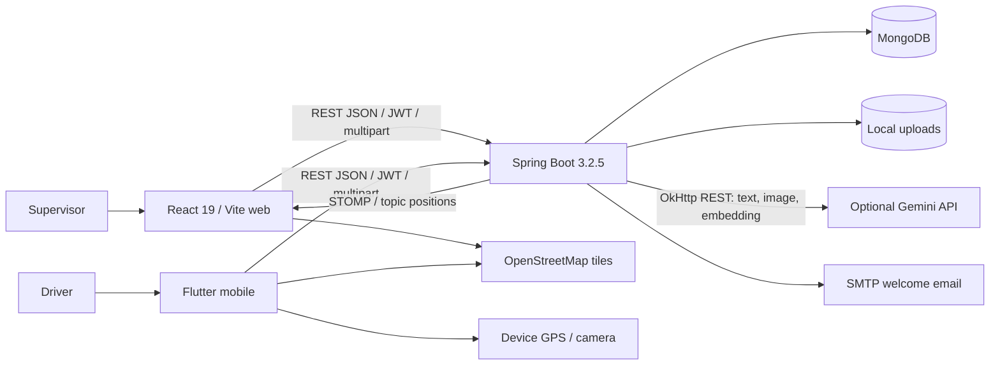
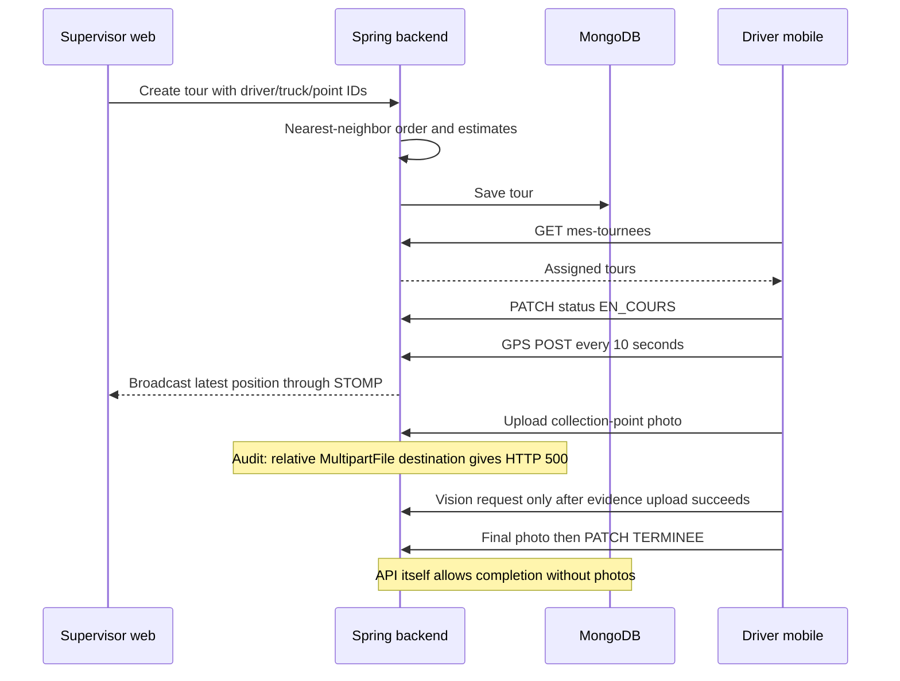

# System architecture

## Current state

The application is a **modular Java monolith with two clients**. Package boundaries organize domains but do not represent separately deployed services. There is one MongoDB data layer and local upload storage. No message broker, Python worker, external vector database or training service is present.



The diagram shows configured integrations, not verified provider success. The checked-in Gemini key is a placeholder; the audit explicitly disabled Gemini/SMTP.

### Web

`W/main.jsx` mounts StrictMode → BrowserRouter → AuthProvider → AppRoutes. A protected MainLayout uses an Outlet for operational pages. Authentication is React Context plus localStorage; page state and filtering use hooks. Axios attaches the JWT and handles 401 centrally. No Redux, server-state cache, TypeScript or app test runner is configured. CSS is mostly local/custom. Leaflet supplies maps; Recharts supplies charts.

Only the routes in AppRoutes are active. The starter `App.jsx` is not mounted. Assistant, photo-analysis, alert and separate report pages exist but are not routed. `/optimisation` redirects to tours; standalone optimization APIs do not power the tour modal.

### Backend

Feature packages generally follow controller → service → Spring Data Mongo repository, with DTOs for core CRUD. Some controllers expose document entities directly and accept untyped maps. Authentication uses BCrypt plus signed JWTs and method-level roles. Validation and error handling are centralized only partly; some malformed requests become generic 500s.

WebSocketConfig enables SockJS at `/ws`, a simple in-process `/topic` broker and `/app` messages. TrackingController stores the latest position per vehicle in a mutable in-memory map and broadcasts it. There is no persistent trajectory or external broker.

### Mobile

`M/main.dart` initializes Dio/preferences, then splash/onboarding and named routes. SharedPreferences stores token and user JSON. Pages call thin service wrappers. The active-tour page manages a position stream, elapsed timer, photo map and dialogs locally. TrackingService independently posts GPS every 10 seconds. There is no background service, durable upload queue, shared tour execution state or recovery protocol.

### Authentication flow

```mermaid
sequenceDiagram
  participant C as Web / Flutter
  participant A as AuthController / AuthService
  participant U as UserService / Mongo users
  C->>A: POST login {email-or-matricule, password}
  A->>U: Lookup user and verify BCrypt
  U-->>A: User and DB role
  A-->>C: Flat AuthResponse with token, id, names, role
  Note over C: Web consumes flat fields; Flutter expects nested user
  C->>A: Authorized API request, Bearer token
  A->>U: JWT filter loads user by email
  Note over U: isEnabled always true; actif not enforced
  A-->>C: Method role check and response
```

JWT lifetime is seven days by default. There is no refresh/revocation flow. The frontend route guard checks authentication, not role. `GET /me` rejects anonymous requests despite the broader permitted `/api/auth/**` pattern. Public upload and WS paths and the anonymous reset endpoint bypass normal API authentication.

### Tour execution and tracking



### Files and background work

CVs, document originals and photos are local files; Mongo stores paths, metadata and references. Static WebConfig exposes upload directories publicly. Resource URLs and roots are inconsistent across frontend/backend; some web photo URLs hardcode localhost:8080. There is no shared storage service, file-to-DB transaction, automatic orphan cleanup or preloading/indexing of existing reference PDFs.

`@EnableAsync` enables email and document processing. EmailService is invoked through a separate bean, so welcome mail can run asynchronously. DocumentProcessingService invokes its own `@Async` method on upload: normal Spring proxy interception is bypassed and indexing runs inline. Controller-triggered reindex crosses the proxy. There is no durable job queue. Periodic work is client timers (document refresh, unread count, GPS); no scheduled backend dispatch/sensor/forecast worker was found.

AI-specific diagrams are in [08](08-ai-ml-architecture.md).

## Problems

Two route engines disagree on the route definition and estimates. Two assistants have different grounding/history behavior. Operational states, physical evidence and AI incidents are loosely linked. Process-local tracking and client-local execution state disappear on restart. Geography, paths and API hosts are environment-coupled.

## Recommendations

Retain the current deployment topology. Share one route contract, add explicit tour state/ownership checks, separate unavailable AI from normal results, and make configuration portable. A small persisted event/measurement model is sufficient if historical analytics become part of the PFE; a new microservice is unnecessary.
