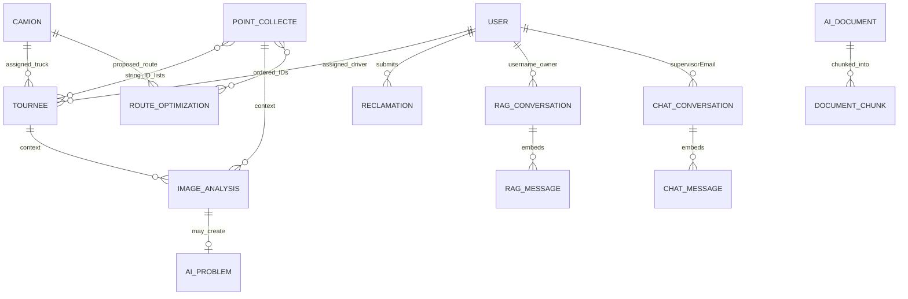

# Data model

## Current state

MongoDB documents use Spring Data `@Document`; references are ordinary string IDs, not database-enforced foreign keys or transactions. `spring.data.mongodb.auto-index-creation=true`. There is no SQL schema or migration history. The existing local `gestion_tournees` database had no collections when inspected; all test data was created in disposable databases on another Mongo port. Existing disk uploads therefore do not establish corresponding DB records.

| Collection / model | Important fields | Relationships / consumers | Integrity observations |
| --- | --- | --- | --- |
| `users` / User | email, matricule, password hash, names, telephone, CIN, address, license/type/expiry, hire date, role, actif, timestamps | Authentication; driver CRUD; tours; complaints | Unique email; unique sparse matricule. actif ignored by UserDetails; startup reactivates drivers |
| `camions` / Camion | unique matricule, make/model/year/type, weight/tank capacity, mileage, status, condition, ESP32 number, maintenance dates, actif | Tours, route proposals, tracking labels | Fields do not imply sensor/maintenance integration; status not synchronized |
| `points_collecte` / PointCollecte | unique reference, address, zone, lat/lon, waste type, fill default 0, actif | Tours and both optimizers; vision | No measurement history; no coordinate/fill ranges; normal edit resets fill |
| `tournees` / Tournee | unique reference, name/date/planned time, truck/driver IDs, point IDs, status, real start/end, distanceParcourue, notes, timestamps | Planning, assigned tours, photos, reports | No reference existence/ownership/lifecycle enforcement; actual distance not computed from saved GPS history |
| Embedded in Tournee | ordered IDs/addresses, distanceOptimaleKm, duration/formatted duration, explanation, optimized flag, photosPoints map, photoFin | Details, mobile, PDF | Duplicated point order becomes stale on clearing; photos map is not a visit event log |
| `reclamations` / Reclamation | title/type/description, driver ID/name, status, response, create/treated times | Driver reports and supervisor replies | No tour/truck/point/photo association; direct entity input accepts null title |
| `alertes` / Alerte | title/description, level/type, sourceId, resolved, dates | Dashboard critical count and unused alert page | Polymorphic sourceId unchecked; sample producer only |
| `candidates` / Candidate | contact/identity/DOB/license, experience/training/skills/languages, CV path/name, score/recommendation/explanation, status/notes/dates | CV screening and driver creation | No agentId, extraction provenance or rubric version; decisions are unconstrained strings |
| `route_optimizations` / RouteOptimization | truck/driver IDs, date, ordered points, estimated km/min/kg/fill/fuel, explanation/algorithm/status/dates | Standalone proposal API | Separate from tours; validating does not schedule one; request date not properly used |
| `image_analyses` / ImageAnalysis | point/tour/driver IDs, photo, status/type/confidence/description/severity, problem flag/ID, human validation/correction, timestamp | Mobile analysis, inactive review page | No model/version/raw response/error state; optional driver ID often null |
| `ai_problems` / AiProblem | image/tour/point/driver/truck IDs, photo/GPS, type/description/confidence/severity/status/note/times | Read-only supervisor problem listing | Created before image ID assigned: backlink can be null; human correction does not reconcile it; no update controller |
| `ai_documents` / AiDocument | original filename/type/size/path, status, chunks, error, uploader, created/indexed | Document administration | File/DB lifecycle not atomic; no corpus/version/hash/source-authority metadata |
| `document_chunks` / DocumentChunk | indexed documentId, filename/type, page/index/section, content, float embedding, created | Retrieval | No embedding provider/model/version/dimension field; no dedicated vector index |
| `rag_conversations` / RagConversation | indexed userId (actually username/email), title, embedded messages, times | Document assistant history | Ownership checked for list, not arbitrary conversationId update |
| Embedded RagMessage | sender/content, sources, highestScore, timestamp | Conversation display | Retrieved relevance is not calibrated answer confidence |
| `chat_conversations` / ChatConversation | supervisorEmail, title, embedded role/content/time messages | Operational supervisor assistant | Separate conversation system; arbitrary supplied ID ownership not checked |
| No collection / VehiculePosition | vehicle/tour identity, GPS, speed, fuel, status, timestamp | TrackingController latestPositions | Process memory only; restart loses all positions; client controls identity |

### Logical ERD

Relationships below describe references in code, **not enforced constraints**. Message records are embedded; files are on disk.

Candidate → User is deliberately absent from the ERD: a service attempts creation, but no persisted linkage exists. Alerts' `sourceId` can name different resource types without an explicit relation. There is no telemetry-to-alert or analysis-to-alert bridge.

### State and data flows

- Tours use enum values `PLANIFIEE`, `EN_COURS`, `TERMINEE`, `ANNULEE`, but arbitrary transitions are accepted. Moving a finished tour back to active retains a finish timestamp in the observed probe.
- Documents use `UPLOADED`, `PROCESSING`, `INDEXED`, `FAILED`; upload can return stale UPLOADED while a subsequent GET already says INDEXED.
- Candidate recommendation and decision are distinct fields, yet eligibility rules automatically set REJETE. Subsequent supervisor decision strings are not validated.
- Core resource deletes generally set `actif=false`; driver deletion supports permanent removal. Tour DELETE cancels. Unchecked string references can outlive related records.

## Problems

Operational facts, estimates, display snapshots and model judgments are stored without sufficient provenance. There is no real collected-weight event, persistent GPS history or actual visit entity, so the current schema cannot substantiate weekly tonnes, road distance, fuel consumption or ML training targets. Historical reports resolve current resource values and may change meaning after edits.

## Recommendations

First enforce required references, ownership, enum values and transitions in services. Keep one canonical point order. Add explicit error/provider metadata to AI records and a candidate-created-driver ID with honest creation results. If measurement experiments are selected, add small visit/tour measurement records with units, timestamps, source and missing-value handling; do not infer that current estimates are real labels.
