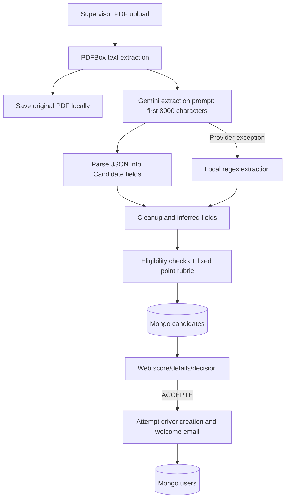
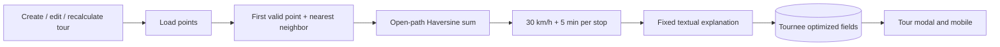
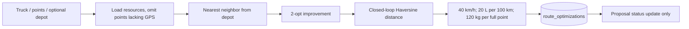
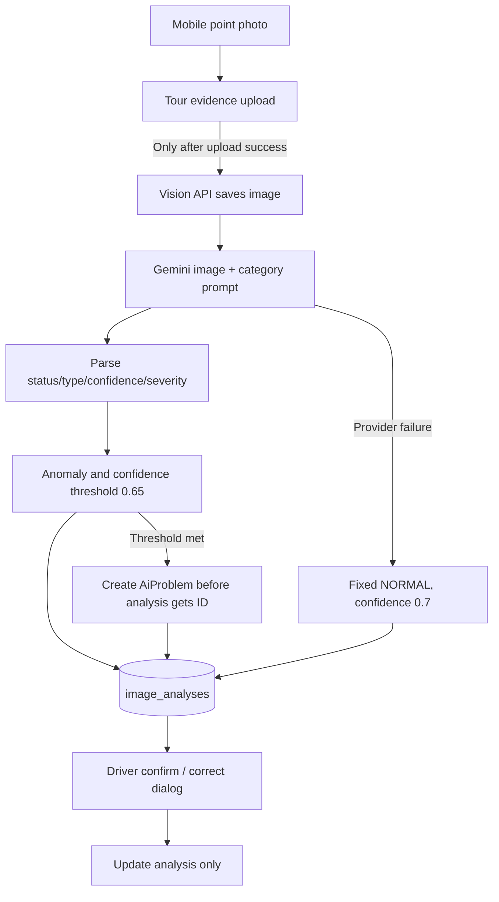
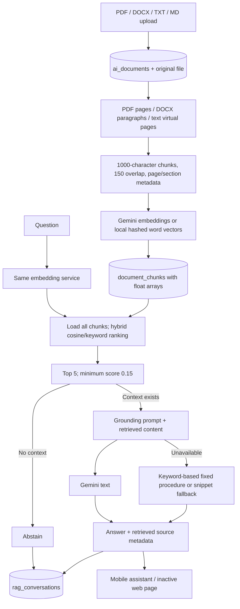
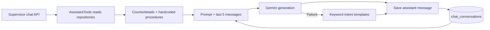

# AI/ML architecture

## Current state

There are **four provider-oriented areas** (CV extraction, vision, document RAG, supervisor chat) and **two deterministic route implementations**. There is no trained local model, training pipeline, model artifact, evaluation dataset or implemented autonomous agent loop. A class named “tools” builds context; it is not LLM function calling.

`B/ai/common/GeminiClient.java` uses OkHttp to call the configured Google REST `generateContent` endpoint. Text calls send a prompt in `contents.parts.text`; vision adds base64 `inline_data` and MIME type. Jackson extracts response text, strips/parses model JSON in callers, and exceptions are wrapped as AiServiceException. Requests do not use a strongly enforced provider response schema. Configured text/vision model: `gemini-1.5-flash`; key: placeholder. Model availability and actual provider behavior are **Needs verification**. The audit did not send CVs or photos to an external provider.

GeminiEmbeddingService implements a separate embedding REST path configured for `text-embedding-004`. Missing/failed credentials invoke a 768-dimensional word-hash fallback. Consumers are not told which representation or generation mode was used.

### CV screening

Malformed model JSON can produce an empty Candidate rather than correctly invoking local extraction. Driver creation has no persistent candidate-to-user link and may silently fail.

### Integrated route engine — active tour workflow

No Gemini call is made. Points lacking GPS are appended without a complete travel estimate. This engine does not use a depot or truck capacity.

### Standalone route engine — separate proposal API

No Gemini call, road network, capacity-constrained assignment or multi-vehicle routing is implemented. The route proposal is not converted into a Tournee by validation.

### Vision

The first upload fails in the audited packaged backend. Direct vision endpoint calls demonstrate its fallback, not successful classification. The human correction does not reconcile the linked problem.

### Document ingestion and retrieval

Despite an `@Async` annotation, upload self-invokes processing and runs inline. Reindex invoked by its controller crosses the proxy. No durable index job exists. Vector search is a Java scan, not a Mongo vector index. Conversation history is saved/displayed but not passed to the RAG generation prompt.

### Operational supervisor assistant

This is a separate system from document RAG, with different storage, response contract and grounding. Its API returns a ChatConversation, not a RagResponse. No active client calls its chat endpoint.

## Problems

Output provenance is lost: “model unavailable,” “regex extraction,” “lexical retrieval,” “fixed procedure,” and “successful inference” are not consistently distinct records or UI states. Model JSON is loosely parsed. There are no recorded prompt versions, retrieval experiments, extraction accuracy, image confusion matrices, latency distributions or route baseline comparisons.

## Recommendations

Make provenance and failure states part of existing DTOs and documents; add small reproducible evaluation fixtures. Use LLMs for text/image interpretation, deterministic code for explicit rules and routing constraints, and postpone trained models until a meaningful labeled dataset exists. See [09](09-ai-feature-audit.md) for exact defects and [14](14-ai-ml-opportunities.md) for feasible experiments.
