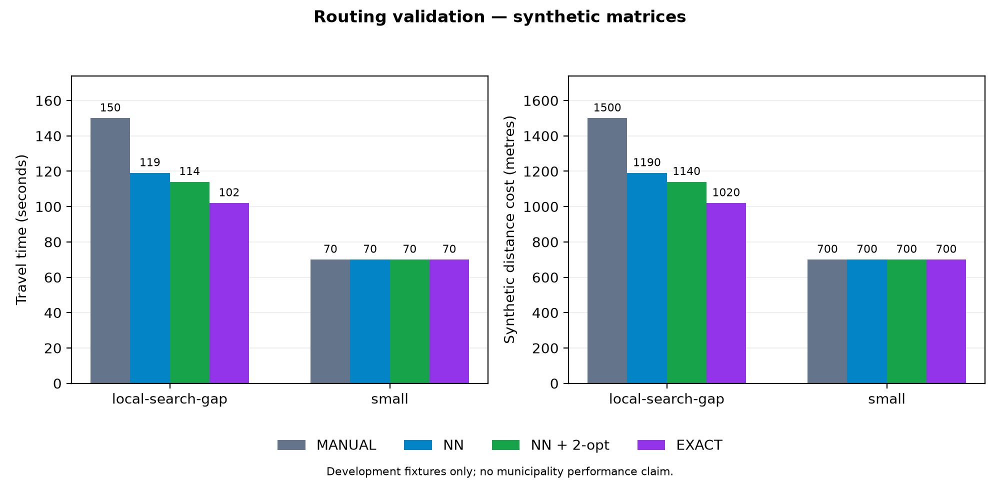

# P1 development results — 17 September 2026

The remaining RAG, candidate and vision evaluation tooling is implemented. These results establish software behavior and provider availability on small, explicitly fictional development inputs. **They are not a reviewed PFE accuracy benchmark.** No real applicant was hired, no external email was sent, and no real municipality procedure or field-cleanliness label was invented.

## Implemented in this continuation

- RAG: supervisor-only approved-corpus export and comparison of BM25, semantic and hybrid retrieval; one compatible query embedding per comparison; fixed corpus/configuration; optional grounded generation; captured sources, settings and latency; independent answer/citation/claim review and split-specific metrics.
- Candidate evaluation: separate field-value and MISSING/INVALID/UNCERTAIN/VERIFIED labels; development/final split separation; provider/extraction strata; explicit synthetic provenance; output validation before requests and saved per-case progress.
- Vision: supervisor-only batch evaluation with AFTER-only and optional paired modes, without changing operational tours; model/prompt checks; image hashes; independent scene labels and explicit unreviewed/provider-failure handling.
- Delivery: rebuilt Android debug APK, bounded live-provider probe, separate-port HTTP regression runner, routing chart generator and a labelled development timing export.

## Observed provider and experiment results

| Area | Observation | Interpretation |
|---|---|---|
| Gemini transport | Configured Flash text probe returned HTTP 200 with valid JSON; embedding returned 768 finite values. | The key and configured models can work. Availability remains intermittent. |
| RAG | Three authored questions × three retrieval modes completed with compatible real embeddings. Eight generation attempts returned unavailable and produced literal excerpts; the lexical salary question returned no context/insufficient information. | Retrieval, follow-up handling, explicit failures and capture work. No successful grounded generated answer or independent grounding score is claimed. |
| Vision | The abstract AFTER-only image returned CANNOT_DETERMINE. Its paired run returned ANALYSIS_UNAVAILABLE. | A real integrated model response and a real failure path were observed. These abstract images cannot support cleanliness accuracy or a comparison of the two modes. |
| Candidate matching | Two fictional DOCX cases completed; both provider calls were unavailable. Applying their authored field corrections produced expected scores 70 and 10, with required criteria MET and UNMET. | Rubric consistency is demonstrated on fixtures. The initial live fallback extraction exposed explicit-label parsing defects, recorded in the original run and subsequently addressed with regression tests. |
| Routing | Two saved synthetic directed matrices replayed through manual, NN, NN + 2-opt and exact algorithms. | Development algorithm checks only; ORS is not configured, so no measured road improvement is claimed. |
| Duration | The completed browser tour recorded 1,636 estimated versus 1,506 elapsed seconds; service comparison is withheld because one stop lacks arrival/service measurements. | Timing arithmetic/completeness works. Browser-testing delays and simulated roads are not field-performance data. |

A bounded check of the previously listed alternative gemini-2.5-flash returned HTTP 404. No model configuration was changed and no automatic fallback was added.

After fixing the CV parser, the two authored DOCX fixtures were replayed against the final backend package with an **explicitly simulated provider outage and zero real model calls**. All 12 expected field values and all 12 field-state labels matched. Applying the authored review values again produced scores 70/10 and required-criteria states MET/UNMET. This is a parser/scoring contract regression, not independently reviewed model accuracy; extracted proposals still require supervisor validation.

## Reproducible artifacts

- [Live provider probe](../evidence/live-provider-check.json) and [alternative availability check](../evidence/stable-alternative-provider-check.json).
- [RAG captured results](../../evaluation/rag/runs/live-development-results.json), [metrics](../../evaluation/rag/runs/live-development-metrics.json) and [empty independent-review template](../../evaluation/rag/runs/live-development-review-template.json). Reviewed retrieval/grounding metrics remain null when independent labels are absent.
- [Candidate development results](../../evaluation/candidates/live-development-results.json). Results are labelled SYNTHETIC_CONTRACT_CHECKS and preserve actual provider-unavailable extraction outcomes separately from fixture field corrections.
- [Post-fix CV outage replay](../../evaluation/candidates/fallback-contract-results.json) and [its manifest](../../evaluation/candidates/fallback-contract-manifest.json). These retain the separate simulated execution context and requirements profile version 3, with the original two-year scoring target restored.
- [Vision raw results](../../evaluation/vision/runs/abstract-transport-001.jsonl) and [metrics](../../evaluation/vision/runs/abstract-transport-001.metrics.json). No independently reviewed classification is available.
- [Routing CSV](../../evaluation/routing/results.csv) and the chart below. The six-stop fixture gives travel costs 150 → 119 → 114 seconds for manual/NN/NN+2-opt, versus exact 102; the heuristic gap remains visible.
- [Browser timing export](../../evaluation/timing/development/browser-tour.json) and [results](../../evaluation/timing/development/results.json).
- [Staged HTTP regression](../evidence/p1-staged-workflow.json) and [evaluation API access checks](../evidence/p1-evaluation-access.json). Latest suite counts are recorded in [implementation progress](../IMPLEMENTATION_PROGRESS.md).

## Remaining acceptance gates

1. Expand the first live ORS check below into reviewed real-road scenarios with the configured depot. Keep the same matrices for all algorithm comparisons.
2. Obtain a successful grounded RAG generation and successful CV provider extraction; re-run paired vision once the provider is available. Do not silently substitute invented outputs.
3. Install the current APK on a physical Android phone. Verify camera/GPS permissions, navigation while tracking, network retry, restart/resume, depot return and supervisor review. No Android device was connected during this continuation.
4. Supply independently reviewed document questions, CV references and staged point photographs. Complete review files against captured outputs and run the existing metrics. Counts remain flexible targets.
5. Record physical execution timings and repeat the combined supervisor/driver demonstration before declaring P0/P1 complete.

P2 summaries and P3 presentation polish remain deferred. See the area READMEs and [DEMO_SETUP.md](../DEMO_SETUP.md) for commands; provider keys stay in the ignored backend .env file.

## Subsequent live ORS check

After the user configured the ORS key, the official matrix endpoint returned HTTP 200. The browser-demo backend was restarted on port 18080 using the live provider and the existing database. The earlier simulated tours and their evidence remain unchanged. A separate planned tour, `ORS-LIVE-T1`, uses three demonstration points and the configured depot (36.722857, 10.283535).

The real matrix and directions requests succeeded. Manual order cost 312.52 seconds and 1,661.92 metres; NN and NN + 2-opt each cost 251.17 seconds and 1,266.36 metres, matching the exact result for this small instance. That is a **19.63% reduction in estimated driving time** for the chosen manual baseline. Service time is 900 seconds; total estimated time is 1,151.17 seconds (rounded up to 20 minutes in the app). The route contains 28 road-geometry vertices and returns to the depot.

An independent permutation check validates all six possible orders against the saved matrix. This particular matrix is symmetric; asymmetric algorithm behavior remains covered by the directed development fixtures. ORS snaps input coordinates to roads, and directions totals were not compared with matrix totals. These demonstration points are not reviewed municipal collection locations, so one successful road scenario does not complete the routing benchmark or physical execution gate.

Evidence: [connectivity](../evidence/live-ors-connectivity.json), [persisted route checks](../evidence/live-ors-workflow.json), [Flutter browser check](../evidence/live-ors-browser.md), [saved matrix/geometry](../../evaluation/routing/live-development/ors-depot-three-stops.json), and [separate road replay results](../../evaluation/routing/live-development-results.csv). The earlier provider table records the original run before the ORS key was configured.
