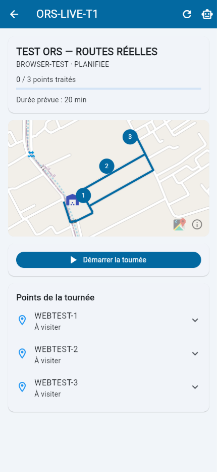

# Live ORS browser check — 17 September 2026

The existing demonstration backend on port 18080 was restarted with the configured ORS key and official `https://api.openrouteservice.org` base URL. Existing MongoDB data and previous simulated tours were retained. Demo authentication tokens were refreshed after restart; a previously open browser may require signing in again. Provider keys remain only in the ignored backend configuration.

The newly created `ORS-LIVE-T1` uses three demonstration points and the configured depot. Authenticated optimization returned a live road matrix and directions geometry. [The persisted checks](live-ors-workflow.json) validate the comparison costs, exact solution, stop order, service time, depot return and export access. It remains planned; this check did not start a physical collection run.

Playwright opened Flutter at `http://127.0.0.1:8088`, signed in with the isolated demo driver, selected the new tour, and inspected the map. At a 430 × 932 viewport after reload, the route, depot marker, numbered stops, ordered visit list and **20 min** rounded total estimate rendered correctly. Reload restored the authenticated home screen and reopening the tour retained its saved route. The browser console still reported Flutter's existing `VideoFrame was garbage collected without being closed` message; no blocking application failure was observed.

This establishes live routing integration and browser rendering. GPS/camera behavior, tracking while Google Maps is open and the physical Android workflow were not revalidated here. The demonstration coordinates are not reviewed municipality collection sites.
